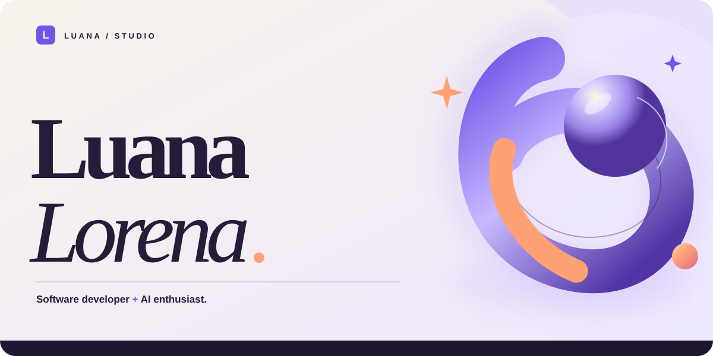
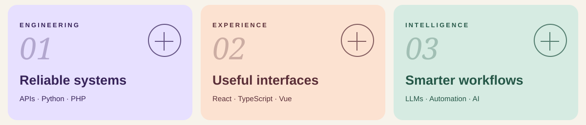

<!-- Luana Lorena / minimalist GitHub profile -->

  <picture>
    <source media="(prefers-color-scheme: dark)" srcset="./assets/cover.svg" />
    <source media="(prefers-color-scheme: light)" srcset="./assets/cover-light.svg" />
    
  </picture>

  <a href="https://github.com/Luanatvrs?tab=repositories"><b>EXPLORE PROJECTS ↗</b></a>

 

  <picture>
    <source media="(prefers-color-scheme: dark)" srcset="./assets/focus.svg" />
    <source media="(prefers-color-scheme: light)" srcset="./assets/focus-light.svg" />
    
  </picture>

 

<b>TECH STACK</b>

  <code>PHP</code> &nbsp; <code>Python</code> &nbsp; <code>FastAPI</code> &nbsp;
  <code>React</code> &nbsp; <code>TypeScript</code> &nbsp; <code>Vue</code> &nbsp;
  <code>MySQL</code> &nbsp; <code>PostgreSQL</code>

 

  Computer Science · UFT &nbsp; / &nbsp; Applied AI · UFPR &nbsp; / &nbsp; Palmas, Brazil

